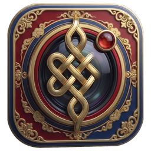
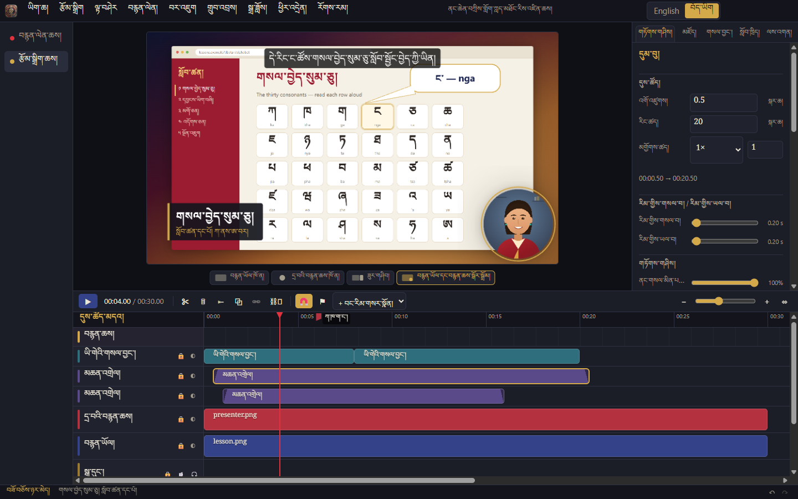
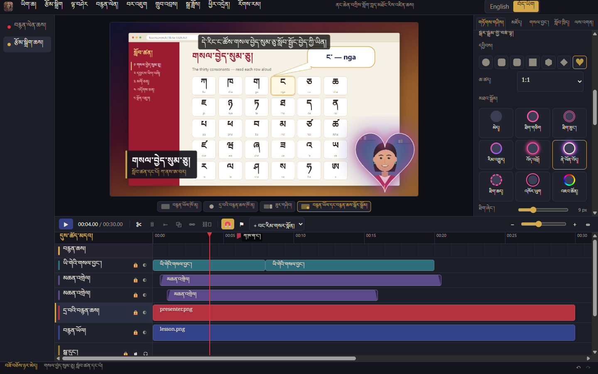
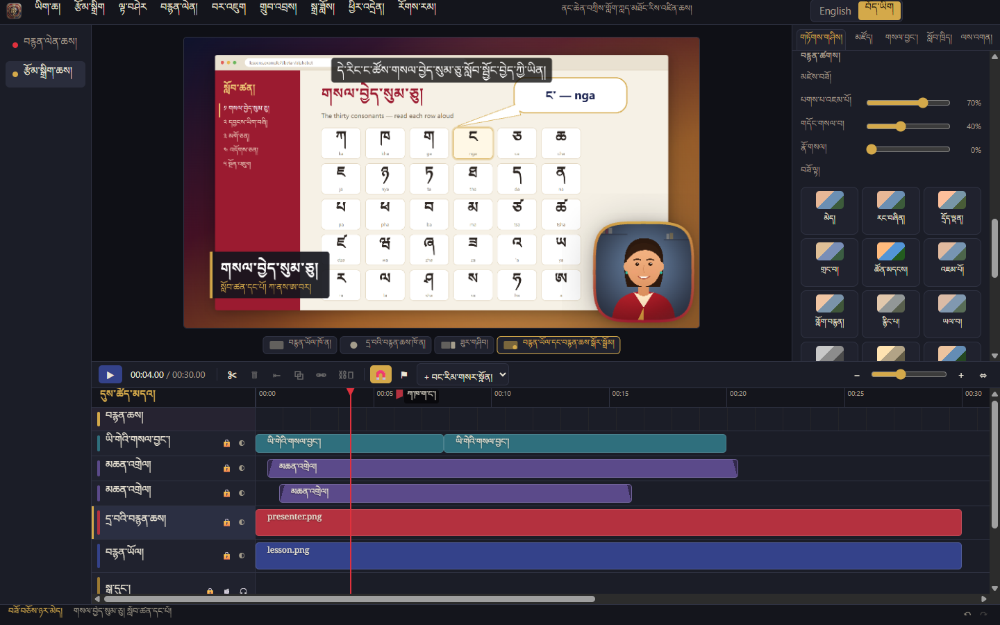
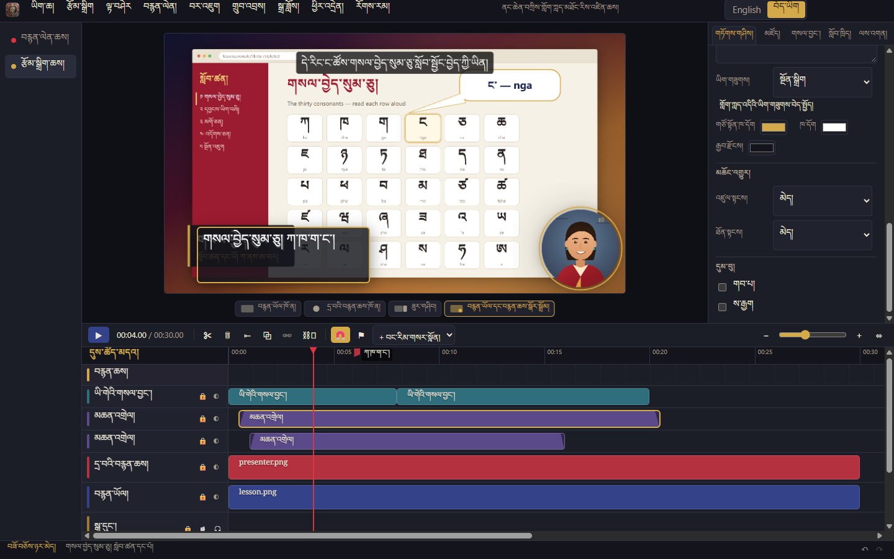
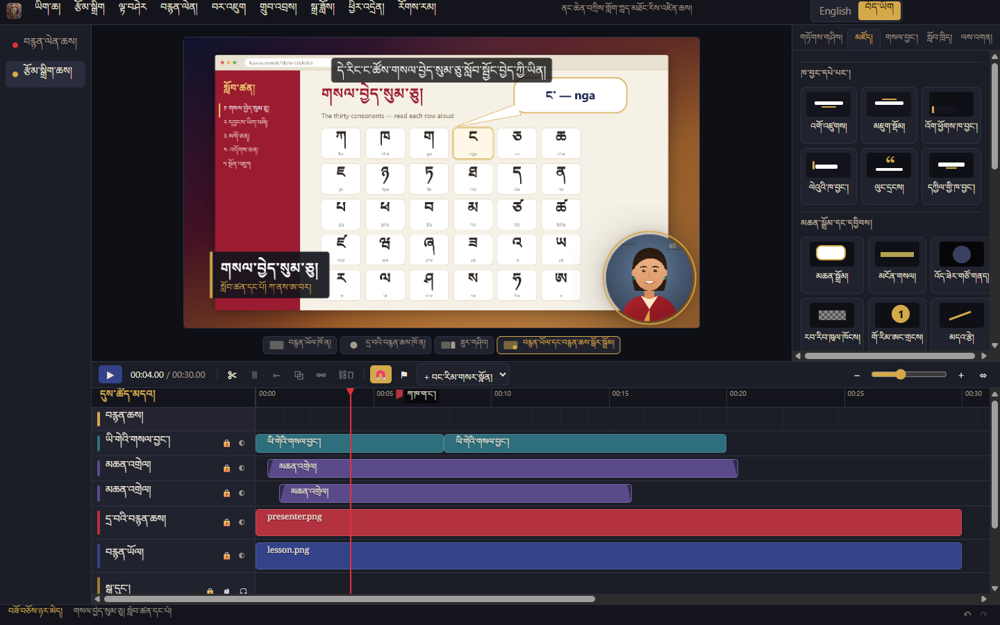
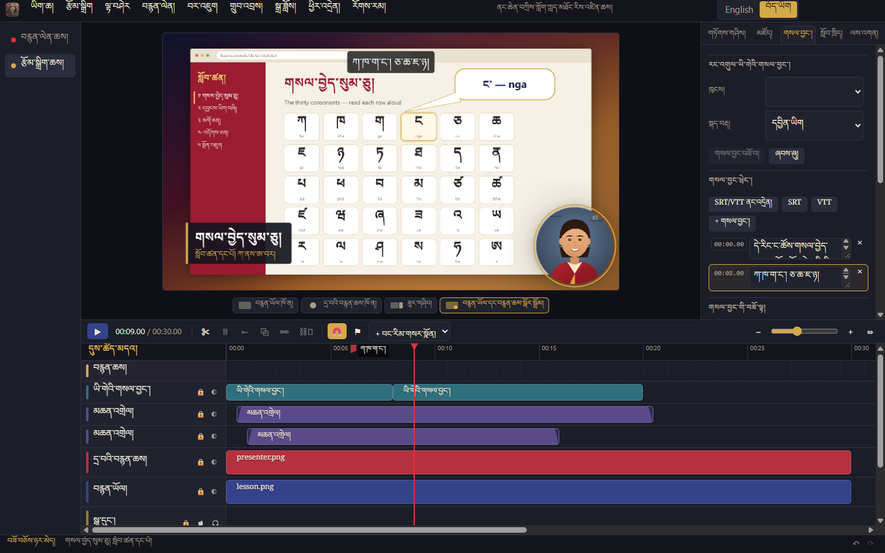
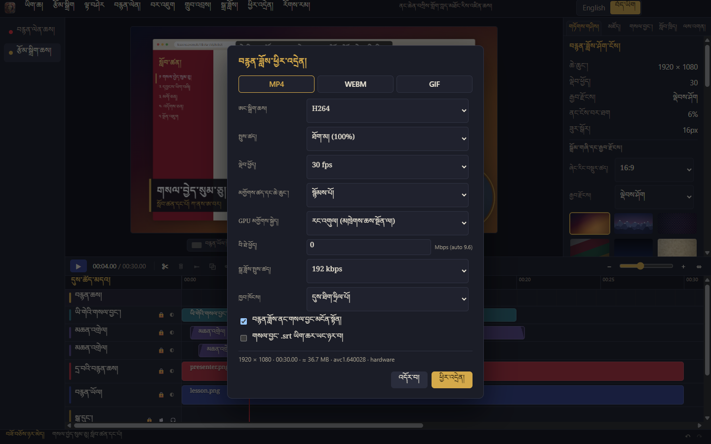

  

# Nangchen T. Studio Screen Recorder · ནང་ཆེན་བཀྲིས་གློག་ཀླད་མཐོང་རིས་འཛིན་ཆས།

A desktop screen recorder and multi-track video editor for teaching, for Windows,
macOS and Linux, with a full Tibetan and English interface.

- Records screen, webcam, microphone and system audio at the same time, each as its
  own file and its own timeline lane, plus cursor/click/keystroke data
- Edit every lane independently: trim, split, move, link/unlink, mute, solo, hide
- Polished results (auto-zoom, cursor effects, styled frames, webcam bubble)
  and teaching tools (callouts, blur, transitions, captions, quizzes)
- Webcam bubble shapes, borders and filters (skin smoothing, one-click looks, colour adjustments)
- Double-click any text or title on the preview to edit it; any font on your computer
- Export the finished video (MP4, WebM, GIF, MP3/WAV) or each track on its own

**Download:** [latest release](https://github.com/tibetanebook-cloud/tibetan-design-recorder/releases/latest) for Windows, macOS and Linux — see [installing](docs/INSTALL.md).

## Screenshots

Shown with the Tibetan interface (switch to English at the top right).

<table>
<tr><td width="50%" valign="top"> <b>ཞུ་དག་ཆས། · The editor</b> Lesson recording with webcam bubble, lower-third title, callout and captions</td><td width="50%" valign="top"> <b>སྒོར་སྒྲོམ་གྱི་བཟོ་ལྟ། · Webcam shapes and borders</b> 7 shapes, 5 proportions, 9 border styles</td></tr>
<tr><td width="50%" valign="top"> <b>བརྙན་ཚགས། · Webcam filters</b> Skin smoothing, brighten, sharpen and 15 one-click looks</td><td width="50%" valign="top"> <b>ཡི་གེ་བཟོ་བཅོས། · Double-click to edit</b> Edit any title or text right on the preview</td></tr>
<tr><td width="50%" valign="top"> <b>ཁ་བྱང་དཔེ་མཛོད། · Titles and library</b> Title templates, callouts, highlights, step numbers</td><td width="50%" valign="top"> <b>ཡི་གེའི་གསལ་བྱང་། · Captions</b> Auto-captions, SRT/VTT import and export, cue editing</td></tr>
<tr><td width="50%" valign="top"> <b>ཕྱིར་འདྲེན། · Export</b> MP4, WebM, GIF and audio with hardware encoding</td></tr>
</table>

## Status

| Stage | | |
|---|---|---|
| 1 | Scaffold, architecture, `.tdrec` projects, autosave and recovery, Tibetan/English UI | ✅ |
| 2 | Recording four separate tracks + cursor data | ✅ (Chromium capture backend; native helpers next) |
| 3 | Multi-track timeline: move/trim/split/ripple/link, snapping, markers, playback, inspector, import, custom shortcuts | ✅ |
| 4 | Polish:  auto-zoom + zoom regions, cursor effects, styled frames, webcam layouts, speed regions, annotations, extensions | ✅ |
| 5 | Teaching and editing tools: callouts, highlight/spotlight, blur/pixelate redaction, transitions, title templates, one-click layouts, audio tools (noise removal, leveling, EQ, compressor), auto-captions + SRT/VTT, green screen, quizzes/chapters/steps/keystrokes, library, background job queue | ✅ (offline speech-to-text and no-green-screen background removal need a model download — see Architecture) |
| 6 | Export: MP4 (H.264/HEVC/AV1 + AAC), WebM (VP9/AV1 + Opus), GIF, MP3/WAV/M4A, every lane as its own file, In/Out range, captions burned in or as .srt, background queue with progress/cancel, batch export of project files; GPU encoding through the encoders built into Electron (no FFmpeg) | ✅ |
| 7 | Tibetan localization review: every screen audited in Tibetan (no English left, Noto Serif Tibetan, line height ≥ 1.8, no clipped stacks), translated native dialogs and recording messages, spelling/punctuation lint, one-term-one-translation check, review spreadsheet + import tool | ✅ (146 new terms await a native speaker's review) |
| 8 | Installers: Windows setup (x64, ARM64) + portable, macOS dmg/zip (Apple Silicon, Intel), Linux AppImage/deb (x64, ARM64); GitHub workflow builds all of them and drafts a release; licence texts shipped; double-clicking a `.tdrec` opens it | ✅ (unsigned; Windows tested here, macOS/Linux build in the workflow) |

## Language

Switch between **English** and **བོད་ཡིག** with the switch at the top right of the
window (or the Language menu on macOS). Tibetan terms come from the
*English–Tibetan–Chinese Information Technology Dictionary*; see
[docs/i18n/TIBETAN_TERMS.md](docs/i18n/TIBETAN_TERMS.md) for the source of each term. How the localization is checked and how to review it:
[docs/i18n/LOCALIZATION.md](docs/i18n/LOCALIZATION.md).

## Docs

- [Installing](docs/INSTALL.md)
- [Release notes](docs/RELEASE_NOTES.md)
- [Build guide](docs/BUILD.md)
- [Architecture](docs/ARCHITECTURE.md)
- [Security](docs/SECURITY.md)

## Licensing note

All code here is original. Recordly (AGPL-3.0) was studied only as a feature reference
through a clean-room process; none of its source code is used.

Third-party libraries used for export, unmodified: `mp4-muxer` and `webm-muxer` (MIT),
`gifenc` (MIT) and `@breezystack/lamejs` (LGPL-3.0; MP3 encoding, kept as a separate
replaceable module). Video and AAC/Opus encoding use the WebCodecs encoders built into
Electron/Chromium, so no FFmpeg is bundled. See [docs/THIRD_PARTY.md](docs/THIRD_PARTY.md).
